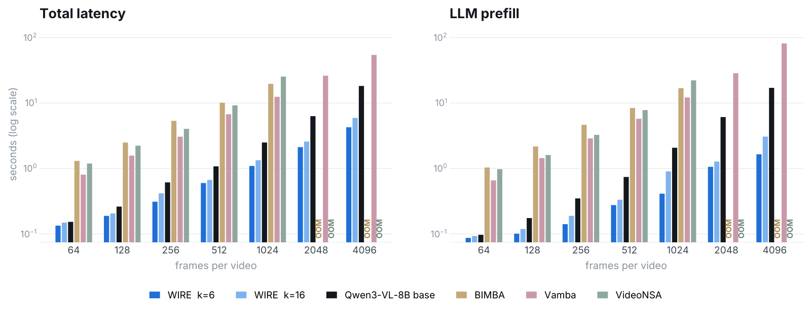
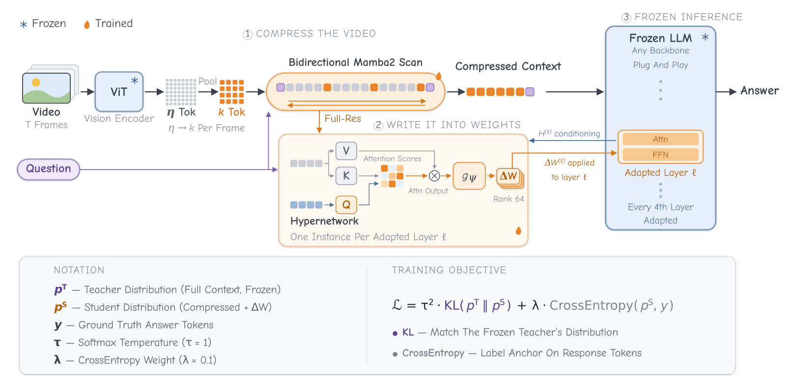

<div align="center">

# WIRE: Weight Space Implicit Representation Encoding of Frozen Video LLMs

[Ameen Ali Ali](https://scholar.google.com/citations?user=p6C3GgoAAAAJ&hl=en)<sup>1</sup>, Tamim Zoabi<sup>1</sup>, [Lior Wolf](https://scholar.google.com/citations?user=UbFrXTsAAAAJ&hl=en)<sup>1</sup>, [Chaim Baskin](https://chaimbaskin.bgu.ac.il/)<sup>2</sup>

<sup>1</sup>Tel Aviv University · <sup>2</sup>INSIGHT Lab, Ben-Gurion University of the Negev

[](https://ameenali.github.io/wire/)
[](https://colab.research.google.com/github/AmeenAli/wire/blob/main/colab/wire_tour.ipynb)
[](LICENSE)



</div>

WIRE compresses the visual tokens of a frozen video language model and adds low-rank weight updates generated from the input. The updates are merged into the weights after prefill, so decoding runs the unmodified backbone over the short input.

This repository holds WIRE for Qwen3-VL-8B with its training and evaluation scripts, the project page and a Colab tour.

## Quick start

1. **Install** on a machine with an NVIDIA GPU. The compressor needs the Mamba2 kernels, which build against the installed PyTorch.

   ```bash
   git clone https://github.com/AmeenAli/wire && cd wire
   pip install torch==2.13.0 torchvision==0.28.0
   pip install --no-build-isolation -e ".[scan]"
   ```

2. **Check the method on a CPU in a few seconds.** The check rebuilds numbers of the paper with the package's own functions: the input length after contraction, the adapted layers and the trained parameters. It also checks the merge after prefill and needs only PyTorch.

   ```bash
   python reproduce/cpu_check.py
   ```

3. **Ask a question about your own video.** The defaults follow the paper: 16 tokens per frame, 256 frames and greedy decoding. The weights download on first use.

   ```bash
   python scripts/answer.py --video my_video.mp4 --question "What does the person do after opening the fridge?"
   ```

   The same in Python, with the generated update switched off for comparison:

   ```python
   from wire import controls
   from wire.inference import generate, prepare_inputs, video_message
   from wire.models import load

   model, processor, _ = load("wire-k16", device="cuda")
   inputs = prepare_inputs(processor, video_message(
       "my_video.mp4", "What does the person do after opening the fridge?"), "cuda")
   print(generate(model, processor, inputs))

   with controls(model, no_update=True):
       print(generate(model, processor, inputs))
   ```

## How it works

<p align="center"></p>

| Step | What it does | Paper | Code |
| --- | --- | --- | --- |
| Compress | A bidirectional selective scan that reads the question at both ends refines a few bilinear queries per frame. | Section 3.2 | `wire/compressor.py` |
| Contract | Each frame's visual tokens are replaced by its refined tokens at original positions. | Section 3.3 | `wire/modeling.py` |
| Generate | At every fourth decoder layer, a hypernetwork reads the forward pass and emits low-rank updates for the attention and feed-forward maps. | Section 3.4 | `wire/hypernet.py` |
| Merge | The updates are merged after prefill, and decoding runs the unmodified backbone. | Section 3.5 | `wire/inference.py` |
| Train | The compressor and the hypernetworks are trained to match the same frozen model reading the full input. | Section 3.6 | `wire/train/`, `scripts/train.sh` |

## Results

On [Qwen3-VL-8B](https://arxiv.org/abs/2511.21631):

- **Decoder prefill runs 3.4× faster** than the uncompressed backbone at 256 frames, **and 4.1× at 1,024** (Table 4). Per-token decoding is unchanged.
- At 256 frames, WIRE reaches its first token **7 to 13× faster** than [BIMBA](https://arxiv.org/abs/2503.09590), [Vamba](https://arxiv.org/abs/2503.11579) and [VideoNSA](https://openreview.net/forum?id=zA2LbsUMDd) (Figure 1).
- With 16 tokens per frame, WIRE has **higher average accuracy than other efficient models** over nine benchmarks at 256 frames (Table 1). This holds for short videos, long videos and overall. Its overall average is **1.9 points above BIMBA's**. The baselines use older 7B backbones.
- Pooled over checkpoints, **the generated update adds 1.96 points** on [Video-MME](https://arxiv.org/abs/2405.21075), 1.22 on [MVBench](https://arxiv.org/abs/2311.17005) and 2.39 on [LongVideoBench](https://arxiv.org/abs/2407.15754) (Figure 4). Counting gains the most among task types.
- A separate variant with 6 tokens per frame, trained with input dropout, **encodes the video in its generated weights**. With no visual tokens, its update raises accuracy on short Video-MME videos **by 11.0 points** (Section 5.4). Another video's update scores 6.78 points lower.

## Reproducing the paper

`reproduce/main_results.sh` evaluates the released models on the nine benchmarks of Table 1. `reproduce/ablations.sh` runs training-free pooling, the uncompressed backbone and the model without its update (Section 5.1 and Appendix E). `scripts/train.sh` trains a model with the settings and stop step of each released model. [REPRODUCING.md](REPRODUCING.md) gives the environment, the data, the commands for Table 1, Section 5.1, the update ablation and training, and the paper's numbers to compare with.

## Models

The four models are trained on top of the frozen [Qwen3-VL-8B-Instruct](https://huggingface.co/Qwen/Qwen3-VL-8B-Instruct), which downloads automatically. Each Hub repository holds the WIRE weights (`wire.safetensors`, about 2 GB) and their configuration.

| Name | Tokens per frame | Hugging Face Hub |
| --- | --- | --- |
| `wire-k16` | 16 | `<HF_ORG>/WIRE-Qwen3-VL-8B-k16` |
| `wire-k12` | 12 | `<HF_ORG>/WIRE-Qwen3-VL-8B-k12` |
| `wire-k8` | 8 | `<HF_ORG>/WIRE-Qwen3-VL-8B-k8` |
| `wire-k6` | 6 | `<HF_ORG>/WIRE-Qwen3-VL-8B-k6` |

The names work in `wire.models.load`, in the `--model` option of `scripts/answer.py` and `eval/videomme/run.py`, and as the first argument of `eval/lmms/run_lmms.sh`. A local checkpoint directory works there as well.

## Repository

```
wire/            the method: compressor, contraction, hypernetworks, merge, inference
wire/train/      training data, distillation loss and trainer
scripts/         answer.py (one video), train.sh (one released model), export_release.py
scripts/data/    construction of the training set
scripts/paper/   MLVU rescoring with the patched answer extraction
eval/            Video-MME harness, and the lmms-eval plugin, tasks and patch
reproduce/       the CPU check, and the runs of Table 1, Section 5.1 and the update ablation
tests/           tests that run on a CPU
colab/           the Colab tour
docs/            the project page (GitHub Pages: main, /docs)
```

## Citation

```bibtex
@misc{ali2026wire,
      title={{WIRE}: Weight Space Implicit Representation Encoding of Frozen Video {LLMs}},
      author={Ameen Ali Ali and Tamim Zoabi and Lior Wolf and Chaim Baskin},
      year={2026},
      note={Preprint},
}
```

## License

The code is released under the Apache 2.0 license ([LICENSE](LICENSE)). The released weights are derived from Qwen3-VL-8B-Instruct and are also subject to its license. The sample clip of the Colab tour, downloaded at run time, and the frames in `docs/assets/img/frames/` come from "Peacock walking and eating" by Mx. Granger on Wikimedia Commons, released under CC0 1.0. The Tel Aviv University logo in `docs/assets/img/logos/` is ["Tel Aviv university logo - English.png"](https://commons.wikimedia.org/wiki/File:Tel_Aviv_university_logo_-_English.png) by Wiki-tau on Wikimedia Commons, under [CC BY-SA 4.0](https://creativecommons.org/licenses/by-sa/4.0/), resized. It is used to show an affiliation.
